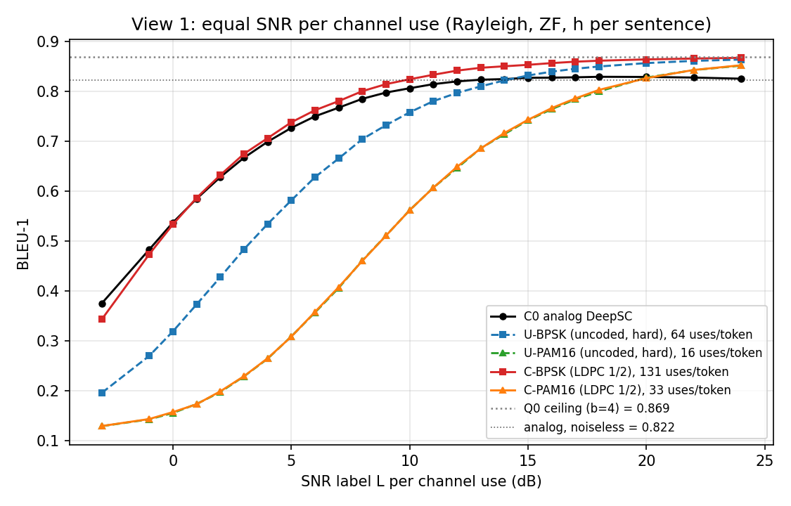

# Quantized DeepSC

A digital version of DeepSC obtained by **quantizing its latent**. The trained DeepSC model is kept frozen. Each real value it would send over the channel is rounded to one of 16 levels (4 bits), and the bits are sent over a standard digital link: Gray labelling, BPSK or 16-PAM, and optionally an LDPC code.

This is one of several ways to make DeepSC digital. It needs no retraining, so it is the baseline that other approaches (for example a learned bit mapper) are compared against.

The code answers one question: **how much text quality (BLEU) does the quantized digital link deliver compared with the original analog DeepSC, at which SNR and at which cost in channel uses?**

## 1. How it works

DeepSC [1] turns each token of a sentence into 16 real numbers (the *latent*) and sends them directly over the channel as analog values. Here a digital link is placed between the DeepSC transmitter and the DeepSC receiver:

```
 frozen DeepSC transmitter               digital link (this code)                         frozen DeepSC receiver
tokens -> encoder -> channel encoder -> t -> quantize -> Gray bits -> [LDPC] -> BPSK / 16-PAM
                                                                                     |
                                                                              channel (AWGN or Rayleigh)
                                                                                     |
          BLEU <- decoder <- channel decoder <- t_hat <- dequantize <- bits <- [BP decoder] <- demapper
```

- `t` has shape `[batch, sentence length, 16]`: 16 real latents per token.
- **Quantizer:** uniform, 4 bits per latent. With `A = 4.54` (the 99.9th percentile of |t|, measured by `calibrate.py`) and step `Delta = 2A/15 = 0.605`, the index is `clip(round((t + A)/Delta), 0, 15)` and the reconstructed value is `-A + index*Delta`.
- **Bits:** each index gets a 4-bit Gray label, so neighbouring levels differ in one bit. A token is 16 x 4 = 64 bits.
- **Modulation:** BPSK (1 bit per channel use) or 16-PAM (4 bits per channel use, i.e. one latent per channel use).
- **Channel code (optional):** a (3,6)-regular LDPC code, block length 1008, rate 1/2, decoded with belief propagation (BP) on soft values (LLRs).
- **Receiver:** the DeepSC decoder receives `t_hat`, the dequantized latent. It is not retrained and does not know that the link is digital.

## 2. Link variants

Every run picks one or more variants. They are defined in `quantized_deepsc/chain.py`.

| Variant | What is sent | Receiver decision | Channel uses per token |
|---|---|---|---|
| `c0` | the 16 analog latents, as in the original DeepSC | none | 16 |
| `q0` | nothing: quantize, then dequantize, with no channel | none | none |
| `u_bpsk` | uncoded bits, BPSK | hard decision | 64 |
| `u_pam16` | uncoded bits, 16-PAM | hard decision (nearest level) | 16 |
| `c_bpsk` | LDPC-coded bits, BPSK | LLR + BP decoding | 130.5 |
| `c_pam16` | LDPC-coded bits, 16-PAM | max-log LLR + BP decoding | 32.6 |

- `c0` is the analog baseline.
- `q0` is the **digital ceiling**: the BLEU of a quantized latent with no bit errors. No digital variant can do better.
- `u_pam16` is the only digital variant with the same number of channel uses as analog.
- The coded variants cost a little more than twice the uncoded ones because the last LDPC block of each sentence is zero-padded.

## 3. Setup

**Python packages**

```
pip install -r requirements.txt
```

Tested with Python 3.14, PyTorch 2.11 (CUDA), NumPy 2.4. A GPU is strongly recommended; the code falls back to the CPU when none is found.

**The DeepSC reference folder (not part of this repository)**

The code imports the original DeepSC implementation and loads a trained checkpoint from a folder that must sit **next to** this one:

```
some_folder/
  DeepSC-continous/            <- reference DeepSC code, data and checkpoint (distributed separately)
    models/transceiver.py
    utils.py
    dataset.py
    europarl/vocab.json
    europarl/test_data.pkl
    checkpoints/deepsc-Rayleigh/checkpoint_80.pth
  DeepSC-quantized/            <- this repository
```

You can also build that folder yourself from the official DeepSC code (https://github.com/13274086/DeepSC): preprocess Europarl with `preprocess_text.py`, then train with `main.py`. Nothing in that folder is modified by this code.

If your folder or checkpoint has another name, change `repo_dir` and `checkpoint` at the top of `quantized_deepsc/config.yaml`.

> The numbers in `REPORT.md` and in `results/` belong to one specific checkpoint (its SHA-256 is in the header of every CSV file). With a different checkpoint, run `python -m quantized_deepsc.calibrate` first and expect different numbers.

## 4. Quick start

All commands are run from the `DeepSC-quantized/` folder.

**1. Run the unit tests** (about 10 seconds; they do not need the DeepSC folder):

```
python -m pytest tests
```

Expected: `27 passed`.

**2. Try three links on a small sample** (500 sentences, two SNR points, about a minute):

```
python -m quantized_deepsc.run_digital --variant c0 u_bpsk c_bpsk --channel rayleigh --subset 500 --snr 6 12 --out-dir results/try
```

One line is printed per SNR point with BLEU-1, the bit error rate (BER), the level error rate (LER), the block error rate (FER), the latent mean squared error and the channel uses per token. One CSV file per variant is written to `results/try/`.

**Useful options of `run_digital`**

| Option | Meaning |
|---|---|
| `--variant` | one or more of `c0 q0 u_bpsk u_pam16 c_bpsk c_pam16` |
| `--channel` | `rayleigh` (default), `awgn` or `none` |
| `--snr` | SNR values in dB; default is 0, 3, ..., 18 |
| `--fine` | adds more SNR points between -3 and 24 dB |
| `--subset` | number of test sentences, or `full` (default 5 000) |
| `--b` | bits per latent (default 4) |
| `--out-dir` | where the CSV files go |

## 5. Reproducing the reported results

The results in `REPORT.md` were obtained with the commands below. Run them **one at a time**; the sweep takes about 1 h 45 min on a laptop RTX 5060.

```
python -m quantized_deepsc.calibrate          # quantizer range A -> results/s1/calibration.json
bash run_dev_sweeps.sh 5000                   # all variants, Rayleigh and AWGN, 5 000 sentences
python -m quantized_deepsc.plot_stages        # one set of figures per stage
python -m quantized_deepsc.run_compare --runs results/s0 results/s3 results/s4 --q0 results/s2 --out results/s5
```

The results are organised in stages, each in its own folder:

| Folder | Stage | Content |
|---|---|---|
| `results/s0` | analog baseline | `c0` on Rayleigh, AWGN and without noise |
| `results/s1` | calibration | quantizer range `A`, latent histogram |
| `results/s2` | quantization only | `q0` for 2 to 8 bits per latent |
| `results/s3` | uncoded links | `u_bpsk`, `u_pam16` |
| `results/s4` | LDPC-coded links | `c_bpsk`, `c_pam16` |
| `results/s5` | comparison | digital against analog in three views (section 7) |

The CSV files and figures of our own run are included, so you can check your numbers against them. `run_full.sh` repeats the comparison on the full test set (120 726 sentences, about 8 hours).

## 6. Conventions you need to know

These are easy to get wrong when comparing with other papers. Section 1 of `REPORT.md` has the complete list.

- **SNR label.** An SNR of `L` dB means noise standard deviation `sigma = 1/sqrt(2 * 10^(L/10))` per real channel use, as in the DeepSC code. All transmitted symbols have unit average energy, so the true ratio of symbol energy to noise variance is `L + 3 dB`.
- **Fading.** Rayleigh fading with **one gain per sentence**, removed at the receiver by zero forcing. The receiver knows the gain. (The original DeepSC code draws one gain per batch of 64 sentences, which gives slightly optimistic results.)
- **Channel uses.** One real number sent over the channel is one channel use. Padding tokens are sent and counted, for the analog and the digital links alike.
- **BLEU.** Sentence-level BLEU-1 to BLEU-4 with greedy decoding, averaged over the sentences. BLEU-1 is the headline number. Its standard error on 5 000 sentences is about 0.004.
- **LLR sign.** A positive LLR means bit 0.

## 7. Main results

BLEU-1 on 5 000 test sentences, Rayleigh fading with one gain per sentence:

| Link | Channel uses per token | 0 dB | 6 dB | 12 dB | 18 dB | 24 dB |
|---|---|---|---|---|---|---|
| Analog DeepSC (`c0`) | 16 | 0.537 | 0.750 | 0.820 | 0.829 | 0.826 |
| Uncoded BPSK (`u_bpsk`) | 64 | 0.319 | 0.628 | 0.797 | 0.850 | 0.864 |
| Uncoded 16-PAM (`u_pam16`) | 16 | 0.155 | 0.357 | 0.646 | 0.800 | 0.852 |
| LDPC + BPSK (`c_bpsk`) | 130.5 | 0.533 | 0.762 | 0.842 | 0.862 | 0.868 |
| LDPC + 16-PAM (`c_pam16`) | 32.6 | 0.157 | 0.358 | 0.649 | 0.803 | 0.853 |

Digital ceiling (`q0`, 4 bits): 0.869. Analog DeepSC without noise: 0.822.



A digital link uses more channel uses than the analog one, so "better at the same SNR" is not the whole story. `run_compare` therefore draws three views:

1. **Equal SNR per channel use** (figure above). LDPC + BPSK matches analog at low SNR and beats it from 3 dB, but it uses 8 times as many channel uses.
2. **Equal energy per token.** Each digital curve is shifted right by `10*log10(channel uses / 16)` dB. In this view analog DeepSC is better than every digital variant up to about 20 dB.
3. **Equal channel uses.** Uncoded 16-PAM against analog. 16-PAM needs about 9 dB more SNR and only passes analog at 20 dB.

The full tables, the AWGN results and the checks that validate each block are in `REPORT.md`.

## 8. Code map

| File | What it does |
|---|---|
| `quantized_deepsc/config.yaml` | all settings: paths, quantizer, LDPC code, SNR grids, seed |
| `quantized_deepsc/deepsc_io.py` | loads the frozen DeepSC and splits it into `encode()` and `decode()`; computes BLEU |
| `quantized_deepsc/quant.py` | uniform scalar quantizer and Gray labels |
| `quantized_deepsc/modulation.py` | BPSK and 16-PAM: mapping, hard decisions, LLRs |
| `quantized_deepsc/channel.py` | AWGN and Rayleigh fading with zero forcing |
| `quantized_deepsc/ldpc.py` | LDPC code construction, encoder and BP decoder |
| `quantized_deepsc/framing.py` | splits the bits of a sentence into code blocks |
| `quantized_deepsc/chain.py` | **the link variants**: puts the blocks above together |
| `quantized_deepsc/calibrate.py` | measures the latent statistics and the quantizer range `A` |
| `quantized_deepsc/run_digital.py` | main script: runs variants over an SNR grid, writes CSV files |
| `quantized_deepsc/run_baseline.py` | shortcut for the analog baseline runs |
| `quantized_deepsc/run_compare.py` | the three comparison views, thresholds and crossovers |
| `quantized_deepsc/plot_stages.py` | figures per stage |
| `tests/` | unit tests for every block and for the whole chain |

A good reading order is `chain.py` first (about 90 lines, the whole link at a glance), then `quant.py`, `modulation.py`, `channel.py`, and `ldpc.py` last.

**Columns of the result CSV files**

| Column | Meaning |
|---|---|
| `bleu1` ... `bleu4` | BLEU scores |
| `ber` | bit error rate after decoding |
| `level_err_rate` | share of latents that come out at a wrong quantizer level |
| `fer` | share of LDPC blocks with at least one wrong information bit |
| `bp_iters_mean` | mean number of BP iterations per block |
| `mse_all`, `mse_nonpad` | mean squared error between `t_hat` and `t`, with and without padding tokens |
| `uses_per_token_all` | channel uses per token (padding tokens included) |

## 9. Adding your own variant

1. Add its name to `VARIANTS` in `chain.py`. The name decides the modulation: names ending in `bpsk` use BPSK, all others 16-PAM.
2. Add a branch in `DigitalChain.run()`. It receives the bit stream `bits` (`[batch, bits per sentence]`), must send symbols through `apply_channel()` and must produce `bits_hat` with the same shape. Channel uses, bit errors and level errors are then counted for you.
3. Add the name to the noiseless test in `tests/test_chain.py`: without noise, every variant must return the quantized latent exactly.
4. Add a label and a line style in `run_compare.py` (`LABELS`, `STYLE`, `DIGITAL`) so that it shows up in the comparison figures.

## 10. Things to keep in mind

- **The decoder prefers slightly noisy inputs.** The checkpoint was trained on Rayleigh fading at 5 to 10 dB. It scores higher on a 4-bit quantized latent (0.869) than on a clean one (0.822), and 3 bits score higher still (0.896). So "digital beats analog at high SNR" really means "4-bit quantization noise suits this decoder better than a clean latent".
- **No coding gain "waterfall" on fading.** With one fading gain per sentence, all blocks of a sentence fail together, so the block error rate falls slowly with SNR. On AWGN the LDPC code has its usual sharp threshold.
- **16-PAM is fragile.** Its 16 levels are close together: at 18 dB on Rayleigh its bit error rate is still 10 %, and the LDPC code cannot repair that.
- **Results are on a subset.** 5 000 of the 120 726 test sentences, one pass. Differences below about 0.006 BLEU-1 between two links are not significant.

## References

[1] H. Xie, Z. Qin, G. Y. Li and B.-H. Juang, "Deep Learning Enabled Semantic Communication Systems," *IEEE Transactions on Signal Processing*, vol. 69, pp. 2663-2675, 2021. Code: https://github.com/13274086/DeepSC
