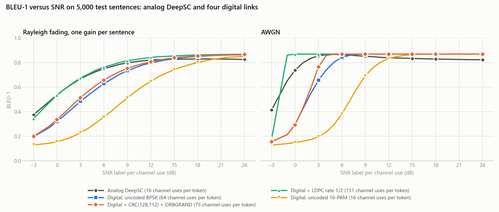
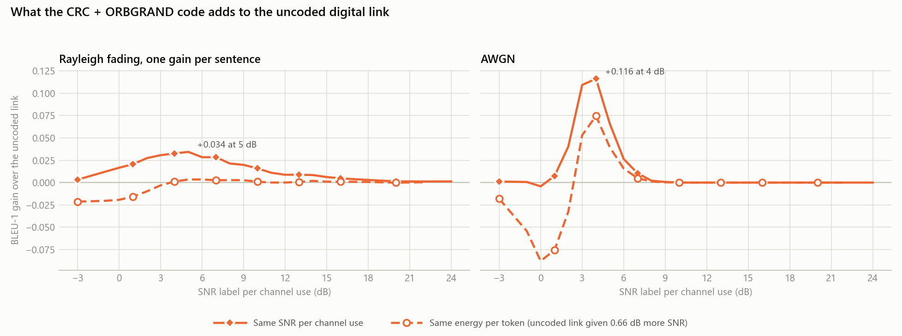
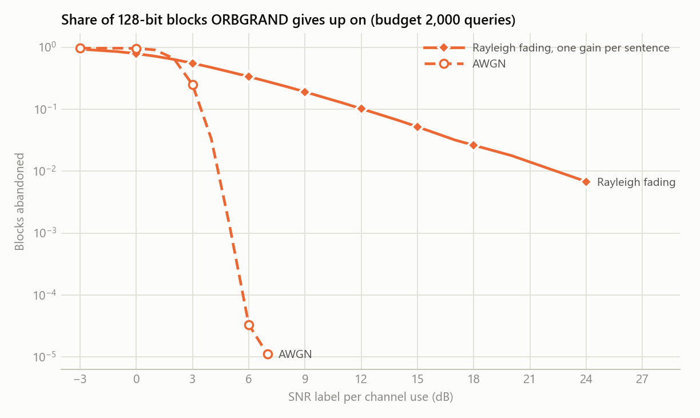

# Quantized DeepSC with GRAND: gains and limitations

Status (2026-11-17): a short high-rate code decoded with ORBGRAND was added to the quantized DeepSC chain and measured on the 5 000-sentence dev subset, on Rayleigh fading and on AWGN. This report extends `REPORT.md`; conventions not restated here are the ones in its section 1.

## 1. Summary

GRAND improves the uncoded BPSK digital link in a narrow SNR window on AWGN and adds almost nothing on Rayleigh fading. It does not help at low SNR.

- **AWGN, 2 to 6 dB:** BLEU-1 rises by up to 0.116 (at 4 dB, from 0.740 to 0.856). The link reaches 95 % of the digital ceiling at 3.7 dB instead of 5.6 dB.
- **Rayleigh fading (one gain per sentence):** BLEU-1 rises by at most 0.034 (at 5 dB). Once the energy spent on the parity bits is counted, the gain is zero within the measurement error.
- **Low SNR (0 dB and below):** no gain. ORBGRAND abandons 79 % of the blocks at 0 dB on Rayleigh and 96 % on AWGN.
- **Against the alternatives:** the rate-1/2 LDPC link is better than GRAND at every SNR, at 1.75 times the channel uses. At equal energy per token, analog DeepSC is better than every digital link up to about 20 dB.
- **Like-for-like with analog:** the only digital link with the same 16 channel uses per token as analog is uncoded 16-PAM. It is far below analog (0.357 against 0.750 at 6 dB on Rayleigh) and only passes it at 20.2 dB on Rayleigh and 12.3 dB on AWGN. GRAND adds nothing to this link at any SNR (section 3.1), so it is left out of the figures and tables.

## 2. What was compared

| Link | Variant | Channel code | Decoder | Channel uses per token |
|---|---|---|---|---|
| Analog DeepSC | `c0` | none (16 real latents sent directly) | none | 16 |
| Digital, uncoded BPSK | `u_bpsk` | none | hard decision | 64 |
| Digital + GRAND | `g_bpsk` | CRC(128,112), polynomial 0x9eb2, rate 0.875 | ORBGRAND (1-line), 2 000 queries per block | 74.6 |
| Digital + LDPC | `c_bpsk` | (3,6)-regular LDPC, n = 1008, rate 1/2 | belief propagation, 50 iterations | 130.5 |
| Digital, uncoded 16-PAM | `u_pam16` | none | hard decision (nearest level) | 16 |

The digital links share the same front end: the 16 latents of each token are quantised to 4 bits each (64 bits per token) and Gray-labelled. The first three send one bit per channel use with BPSK. The 16-PAM link sends the 4 bits of a latent as one of 16 amplitude levels in a single channel use, so it needs 16 channel uses per token, the same as analog. All links use the same frozen DeepSC model (`checkpoint_80`) and the same receiver network.

Because every link sends unit-energy symbols at the same SNR label, a link's energy per token is proportional to its channel uses. Uncoded 16-PAM is therefore the only digital link that matches analog in both energy and bandwidth at the same SNR label; the BPSK links spend 4 to 8 times more of both.

How the GRAND link works:

- **Framing:** the bits of one sentence are split into blocks of 112, zero-padded at the end. The padding is why the link costs 74.6 channel uses per token and not 64 / 0.875 = 73.1.
- **Decoding:** the demapper gives one LLR per bit (it knows the fading gain). ORBGRAND guesses error patterns in order of likelihood until the result is a codeword.
- **Fallback:** a block that is still not decoded after 2 000 guesses is "abandoned" and keeps its hard decisions, which is what the uncoded link would have delivered.
- **No interleaver:** the fading gain is constant over a sentence and AWGN is memoryless, so there is nothing to spread within a sentence.

Setup: first 5 000 sentences of the Europarl test set, batch 64, one pass, seed 1234, greedy decoding, BLEU-1 with reference = target. The SNR label L is per channel use, with noise standard deviation 1/sqrt(2·10^(L/10)) per real dimension and unit-energy symbols. The standard error of a BLEU-1 value is about 0.004.

## 3. Results



**BLEU-1, Rayleigh fading, one gain per sentence**

| Link | −3 dB | 0 dB | 3 dB | 6 dB | 9 dB | 12 dB | 15 dB | 18 dB | 24 dB |
|---|---|---|---|---|---|---|---|---|---|
| Analog DeepSC | 0.375 | 0.537 | 0.667 | 0.750 | 0.798 | 0.820 | 0.827 | 0.829 | 0.826 |
| Digital, uncoded BPSK | 0.196 | 0.319 | 0.483 | 0.628 | 0.732 | 0.797 | 0.832 | 0.850 | 0.864 |
| Digital + GRAND | 0.199 | 0.335 | 0.514 | 0.656 | 0.752 | 0.806 | 0.838 | 0.853 | 0.865 |
| Digital + LDPC | 0.343 | 0.533 | 0.675 | 0.762 | 0.815 | 0.842 | 0.853 | 0.862 | 0.868 |
| Digital, uncoded 16-PAM | 0.129 | 0.155 | 0.228 | 0.357 | 0.511 | 0.646 | 0.742 | 0.800 | 0.852 |

**BLEU-1, AWGN**

| Link | −3 dB | 0 dB | 2 dB | 3 dB | 4 dB | 5 dB | 6 dB | 9 dB | 12 dB | 24 dB |
|---|---|---|---|---|---|---|---|---|---|---|
| Analog DeepSC | 0.414 | 0.738 | 0.834 | 0.855 | 0.864 | 0.867 | 0.864 | 0.851 | 0.838 | 0.823 |
| Digital, uncoded BPSK | 0.154 | 0.295 | 0.546 | 0.656 | 0.740 | 0.803 | 0.842 | 0.868 | 0.869 | 0.869 |
| Digital + GRAND | 0.156 | 0.291 | 0.586 | 0.765 | 0.856 | 0.869 | 0.869 | 0.869 | 0.869 | 0.869 |
| Digital + LDPC | 0.177 | 0.869 | 0.869 | 0.869 | 0.869 | 0.869 | 0.869 | 0.869 | 0.869 | 0.869 |
| Digital, uncoded 16-PAM | 0.127 | 0.149 | 0.172 | 0.195 | 0.234 | 0.295 | 0.381 | 0.692 | 0.833 | 0.870 |

**SNR needed to reach a share of the digital ceiling (0.869)**

| Link | Rayleigh, 90 % | Rayleigh, 95 % | AWGN, 90 % | AWGN, 95 % |
|---|---|---|---|---|
| Analog DeepSC | 7.9 dB | 14.3 dB | 0.8 dB | 1.8 dB |
| Digital, uncoded BPSK | 11.1 dB | 14.4 dB | 4.7 dB | 5.6 dB |
| Digital + GRAND | 10.5 dB | 13.6 dB | 3.2 dB | 3.7 dB |
| Digital + LDPC | 7.1 dB | 10.2 dB | −1.2 dB | −1.1 dB |
| Digital, uncoded 16-PAM | 16.9 dB | 19.9 dB | 10.6 dB | 11.8 dB |

The digital ceiling is the BLEU-1 of the quantised latent with no bit errors. Every digital link reaches it exactly once its bit error rate is zero.

### 3.1 Like-for-like with analog: uncoded 16-PAM

Analog DeepSC and uncoded 16-PAM both use 16 channel uses per token, so at the same SNR label they spend the same energy and the same bandwidth. This is the comparison in which a digital link replaces the analog one at no extra cost.

| Channel | Analog reaches 90 % of the ceiling at | 16-PAM reaches it at | 16-PAM passes analog at | Largest deficit of 16-PAM |
|---|---|---|---|---|
| Rayleigh | 7.9 dB | 16.9 dB | 20.2 dB | −0.44 BLEU-1 at 3 dB |
| AWGN | 0.8 dB | 10.6 dB | 12.3 dB | −0.66 BLEU-1 at 2 dB |

- 16-PAM needs 9 to 10 dB more SNR than analog to reach 90 % of the ceiling. Its 16 levels sit close together, so its raw bit error rate is still 10 % at 18 dB on Rayleigh.
- It passes analog at high SNR only because analog saturates at 0.83 while 16-PAM keeps rising to the digital ceiling.
- **GRAND on 16-PAM gives no gain.** The variant `g_pam16` (same CRC(128,112) code and budget, 18.6 channel uses per token) was run on the same 5 000 sentences and both channels. At the same SNR label its BLEU-1 differs from uncoded 16-PAM by between −0.005 and +0.004 at every SNR, which is within the measurement error. At the same energy per token it is worse, by up to 0.034 on Rayleigh and 0.072 on AWGN. It is therefore not shown in the figures and tables; the raw results are in `results/s6/g_pam16_*.csv`.
- **Why it fails.** Wherever 16-PAM is below the ceiling, its raw bit error rate is far beyond the code: 10 % to 44 % up to 18 dB on Rayleigh, with 75 % to 97 % of blocks abandoned, and 97 % abandoned up to 16 dB on AWGN. Most of these errors move a latent to a neighbouring level, which the DeepSC decoder tolerates but the code cannot. By the time the bit error rate is low enough for ORBGRAND to work (AWGN from about 20 dB), uncoded 16-PAM is already at the ceiling.

## 4. Gains



The figure and the table below give the BLEU-1 of the GRAND link minus that of the uncoded BPSK link (called "the uncoded link" in this section and the next), in two ways. "Same SNR" compares the two at the same SNR label. "Same energy" gives the uncoded link 0.66 dB more SNR, which is the energy the GRAND link spends on its parity bits and padding (10·log10(74.6/64)).

| Channel | Comparison | −3 dB | 0 dB | 3 dB | 4 dB | 5 dB | 6 dB | 9 dB | 12 dB | 18 dB |
|---|---|---|---|---|---|---|---|---|---|---|
| Rayleigh | same SNR | +0.003 | +0.017 | +0.031 | +0.033 | +0.034 | +0.028 | +0.020 | +0.009 | +0.003 |
| Rayleigh | same energy | −0.021 | −0.019 | −0.003 | +0.001 | +0.003 | +0.003 | +0.003 | +0.000 | +0.001 |
| AWGN | same SNR | +0.001 | −0.004 | +0.109 | +0.116 | +0.066 | +0.026 | +0.001 | 0 | 0 |
| AWGN | same energy | −0.018 | −0.088 | +0.053 | +0.075 | +0.039 | +0.016 | 0 | 0 | 0 |

1. **AWGN, 2 to 6 dB: a real gain.** At 3 and 4 dB the code removes most bit errors (bit error rate 2.3 % to 0.96 % at 3 dB, 1.3 % to 0.11 % at 4 dB). The gain survives the energy correction: +0.053 at 3 dB and +0.075 at 4 dB.
2. **The link reaches its ceiling earlier.** On AWGN the GRAND link is at the ceiling from 5 dB; the uncoded link gets within 0.001 of it at 9 dB. The 95 % threshold moves by 1.9 dB on AWGN and by 0.75 dB on Rayleigh.
3. **Low overhead.** The gain on AWGN costs 17 % more channel uses than the uncoded link. The LDPC link costs 104 % more.
4. **Low decoding effort where it works.** On AWGN a block needs 14 queries on average at 5 dB, 2 at 6 dB and about 1 from 9 dB.
5. **It never does harm at the same SNR.** Abandoned blocks fall back to hard decisions, so the GRAND link is never clearly below the uncoded one at the same SNR label (largest deficit −0.004, within the error).

## 5. Limitations



**Limits of GRAND in this system**

1. **No help at low SNR.** A CRC(128,112) code has 16 parity bits and can only repair a few errors per block. At 0 dB the raw bit error rate is 7.9 % on AWGN and 14.4 % on Rayleigh, i.e. 10 to 18 wrong bits per block, and ORBGRAND abandons 96 % and 79 % of the blocks.
2. **Break-even on Rayleigh fading.** With one gain per sentence, a sentence is either in a deep fade (all its blocks fail) or not (few errors to fix). The share of abandoned blocks therefore falls slowly, by about a factor of 10 per 10 dB, instead of dropping off a cliff as on AWGN. At the same energy per token the gain is between −0.003 and +0.003 from 3 dB up, which is zero within the standard error of 0.004, and it is negative (−0.02) below 3 dB.
3. **Below its working range the code costs energy.** At the same energy per token the GRAND link is worse than the uncoded one below about 2.5 dB on AWGN (−0.088 at 0 dB) and below 3 dB on Rayleigh.
4. **LDPC is better everywhere.** The rate-1/2 LDPC link is at the ceiling on AWGN from 0 dB and is the only digital link that matches analog DeepSC at low SNR on Rayleigh. GRAND cannot decode that code (504 parity bits; the guessing effort grows with the number of parity bits), so it is restricted to short high-rate codes.
5. **Analog DeepSC stays ahead at equal energy.** GRAND does not change the conclusion of `REPORT.md`: per unit of energy, analog DeepSC beats every digital link up to about 20 dB on Rayleigh. The digital links win above that only because analog saturates at 0.83 while they rise to 0.869.
6. **Miscorrections.** Up to 3 % of the blocks are decoded to a wrong codeword at low SNR (2.4 % at 0 dB on Rayleigh, 3.0 % on AWGN), which matches the chance of a false hit within 2 000 guesses among 2^16 syndromes. The rate falls with SNR (0.08 % at 18 dB on Rayleigh).
7. **Decoding effort at low SNR.** At 0 dB and below most blocks use nearly the whole budget (1 600 to 1 970 queries per block on average) and still fail.

**Limits of this experiment**

- One code (CRC(128,112)) and one query budget (2 000), on BPSK and on 16-PAM (section 3.1). Other code rates and a larger budget were not tried.
- Hard output only. ORBGRAND itself uses the soft values (LLRs) from the demapper, but what the DeepSC network receives is always a hard decision: each latent is set to one of its 16 quantiser levels. A soft fallback was not tried, i.e. giving the network, for the bits of an abandoned block, the average of the levels weighted by their probabilities instead of a possibly wrong level.
- Dev subset only: 5 000 of 120 726 test sentences, one pass. The links do not share noise realisations, so differences below about 0.006 BLEU-1 are not significant.
- BLEU-1 is the headline metric; BLEU-2 to BLEU-4 are in the CSV files.
- Fading is one gain per sentence. With fading that changes within a sentence, or an interleaver across sentences, the errors would no longer cluster in whole sentences and a short code would be expected to gain more. This was not measured.
- The DeepSC model is frozen. As `REPORT.md` shows, its decoder scores higher on a 4-bit quantised latent (0.869) than on a clean one (0.822), which is why the digital ceiling lies above the analog curve at high SNR.

**Block statistics of the GRAND link**

| Channel | SNR | Raw bit error rate | Bit error rate after GRAND | Blocks abandoned | Blocks miscorrected | Mean queries per block |
|---|---|---|---|---|---|---|
| Rayleigh | 0 dB | 14.4 % | 14.2 % | 79 % | 2.4 % | 1 638 |
| Rayleigh | 6 dB | 5.2 % | 4.9 % | 34 % | 1.0 % | 714 |
| Rayleigh | 12 dB | 1.5 % | 1.4 % | 10 % | 0.33 % | 220 |
| Rayleigh | 18 dB | 0.39 % | 0.35 % | 2.6 % | 0.08 % | 57 |
| Rayleigh | 24 dB | 0.090 % | 0.080 % | 0.68 % | 0.02 % | 16 |
| AWGN | 0 dB | 7.9 % | 7.9 % | 96 % | 3.0 % | 1 962 |
| AWGN | 2 dB | 3.8 % | 3.1 % | 66 % | 1.9 % | 1 488 |
| AWGN | 3 dB | 2.3 % | 0.96 % | 25 % | 0.77 % | 694 |
| AWGN | 4 dB | 1.3 % | 0.11 % | 3.4 % | 0.12 % | 144 |
| AWGN | 5 dB | 0.60 % | 0.003 % | 0.12 % | 0.002 % | 14 |
| AWGN | 6 dB | 0.24 % | 0.00004 % | 0.003 % | 0 | 2 |

## 6. Files and reproduction

| What | Where |
|---|---|
| GRAND link | `quantized_deepsc/chain.py` (variants `g_bpsk`, `g_pam16`), `quantized_deepsc/grand_code.py` |
| ORBGRAND decoder and CRC code | `../../BitSemCom/grand/` (loaded in place; port of K. R. Duffy's GRAND-MATLAB, non-commercial academic licence) |
| Settings | `quantized_deepsc/config.yaml`, entry `grand` |
| Tests | `tests/test_grand.py` (8 tests; 35 in total with the existing ones) |
| GRAND results | `results/s6/g_bpsk_rayleigh_sentence.csv`, `results/s6/g_bpsk_awgn_-.csv` |
| GRAND on 16-PAM (no gain, not plotted) | `results/s6/g_pam16_rayleigh_sentence.csv`, `results/s6/g_pam16_awgn_-.csv` |
| Analog, uncoded (BPSK and 16-PAM) and LDPC results | `results/s0`, `results/s3`, `results/s4` (runs of 2026-09-09) |
| Figures and numbers of this report | `results/s7/grand_bleu1.png`, `grand_gain.png`, `grand_blocks.png`, `grand_numbers.json` |
| Comparison in the three views of `REPORT.md` | `results/s7/s5_bleu1_vs_snr_view{1,2,3}.png`, `s5_bleu1_vs_snr_awgn.png`, `summary.md` |

Commands, run from `DeepSC-quantized/`, one at a time (about 17 minutes in total on the RTX 5060 laptop; ORBGRAND runs on one CPU core). The 16-PAM runs use `--variant g_pam16` in the two `run_digital` commands and take about 45 minutes more.

```
python -m pytest tests
python -m quantized_deepsc.run_digital --variant g_bpsk --channel rayleigh --h-draw sentence --fine --out-dir results/s6
python -m quantized_deepsc.run_digital --variant g_bpsk --channel awgn --fine --out-dir results/s6
python -m quantized_deepsc.run_compare --runs results/s0 results/s3 results/s4 results/s6 --q0 results/s2 --out results/s7
python -m quantized_deepsc.plot_grand --runs results/s0 results/s3 results/s4 results/s6 --out results/s7
```

Other codes and budgets: `--grand-code crc:0x9eb2:128:112` (or `rlc:<n>:<k>:<seed>`) and `--grand-budget <queries>`.
